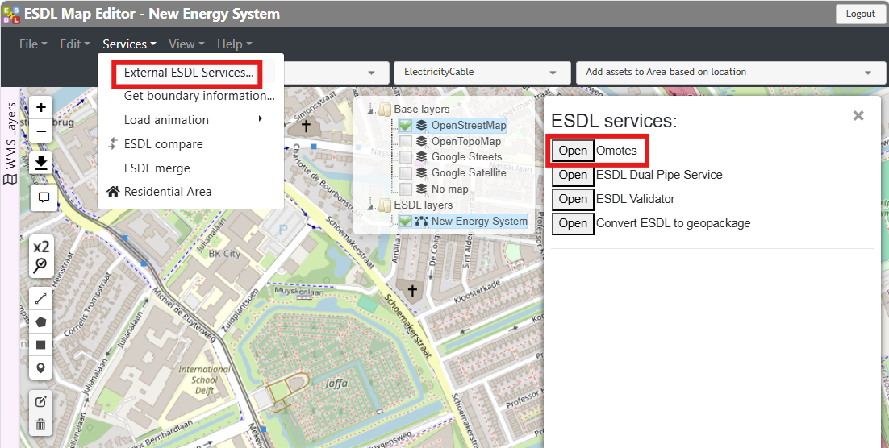
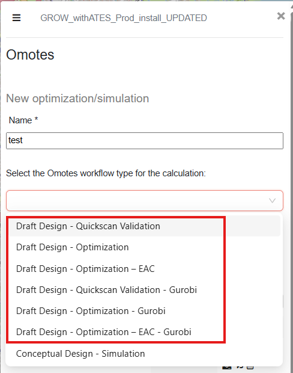

DTK Workflows
=========

This page elaborates on the available Design Toolkit optimization workflows that are supported by MESIDO:

* :ref:`draft_design_quickscan_validation-section`
* :ref:`draft_design_optimization-section`
* :ref:`draft_design_optimization_eac-section`
* :ref:`draft_design_quickscan_validation_gurobi-section`
* :ref:`draft_design_optimization_gurobi-section`
* :ref:`draft_design_optimization_eac_gurobi-section`

These supported workflows are available through Omotes in the ESDL MapEditor, which is accessed as follows:

.. _image_omotes_workflow_access:

    Accessing Omotes.

The available workflows can be selected from the Omotes workflow selection menu, as shown below:

.. _image_omotes_workflows:

    Available workflows.

The individual workflows are described in the sections below.

.. _draft_design_quickscan_validation-section:
Draft Design - Quickscan Validation
-----------------------------------

"Draft Design - Quickscan Validation" workflow is designed to optimize a heating network excluding the heat
losses in the network. This allows for a much faster optimization than other optimization workflows. It is suggested to
be used in the initial design phase of the large networks for fast iterations and/or debugging potential errors in the
input ESDL file in a shorter time-frame. The optimization objective function includes the total OPEX of all assets and CAPEX of selected optional assets. This workflow uses `HiGHS <https://highs.dev//>`_ as the optimization solver.

For more details regarding this workflow and the cost aspects used in the workflow see :ref:`regular-cost-section` and
:ref:`end_scenario_sizing_no_heat_loss-section` section, respectively.

.. _draft_design_optimization-section:
Draft Design - Optimization
-----------------------------------

"Draft Design - Optimization" workflow is designed to optimize a heating network. The optimization objective function
includes the total OPEX of all assets and CAPEX of selected optional assets. This workflow uses
`HiGHS <https://highs.dev//>`_ as the optimization solver.

For more details regarding this workflow and the cost aspects used in the workflow see :ref:`regular-cost-section` and
:ref:`end_scenario_sizing-section` sections, respectively.

.. _draft_design_optimization_eac-section:
Draft Design - Optimization - EAC
-----------------------------------

"Draft Design - Optimization - EAC"  workflow is designed to optimize a heating network. The optimization objective
function includes the total the Equivalent Annual Cost (EAC) of OPEX of all assets and the Equivalent Annual Cost (EAC)
of CAPEX of selected optional assets. This workflow uses `HiGHS <https://highs.dev//>`_ as the optimization solver.

For more details regarding this workflow and the cost aspects used in the workflow see :ref:`discounted-cost-section`
and :ref:`end_scenario_sizing_discounted-section` sections, respectively.

.. _draft_design_quickscan_validation_gurobi-section:
Draft Design - Quickscan Validation - Gurobi
--------------------------------------------

"Draft Design - Quickscan Validation - Gurobi" workflow is designed to optimize a heating network. Problem
formulation and the objective function are the same as in the :ref:`draft_design_quickscan_validation-section` workflow.
The difference is that this workflow uses `Gurobi Optimizer <https://www.gurobi.com/>`_ as the optimization solver.

Due to limited availability of Gurobi licenses, this workflow is recommended to be used only for very large networks where
other optimization workflows take too long to converge.

.. _draft_design_optimization_gurobi-section:
Draft Design - Optimization - Gurobi
--------------------------------------------

"Draft Design - Optimization - Gurobi" workflow is designed to optimize a heating network. Problem
formulation and the objective function are the same as in the :ref:`draft_design_optimization-section` workflow.
The difference is that this workflow uses `Gurobi Optimizer <https://www.gurobi.com/>`_ as the optimization solver.

Due to limited availability of Gurobi licenses, this workflow is recommended to be used only for very large networks where
other optimization workflows take too long to converge.

.. _draft_design_optimization_eac_gurobi-section:
Draft Design - Optimization - EAC - Gurobi
--------------------------------------------------

"Draft Design - Optimization - EAC - Gurobi" workflow is designed to optimize a heating network. Problem formulation
and the objective function are the same as in the :ref:`draft_design_optimization_eac-section` workflow. The difference is that
this workflow uses `Gurobi Optimizer <https://www.gurobi.com/>`_ as the optimization solver.

Due to limited availability of Gurobi licenses, this workflow is recommended to be used only for very large networks where
other optimization workflows take too long to converge.
